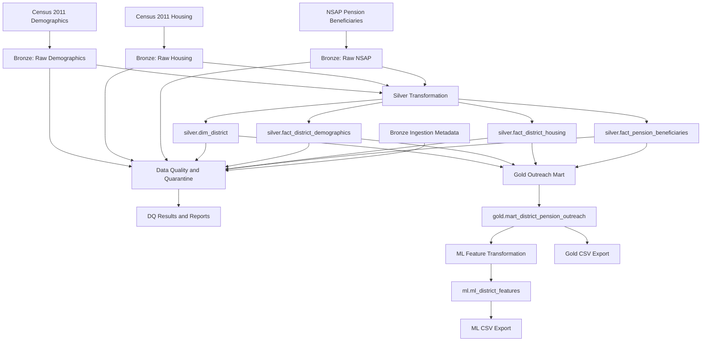
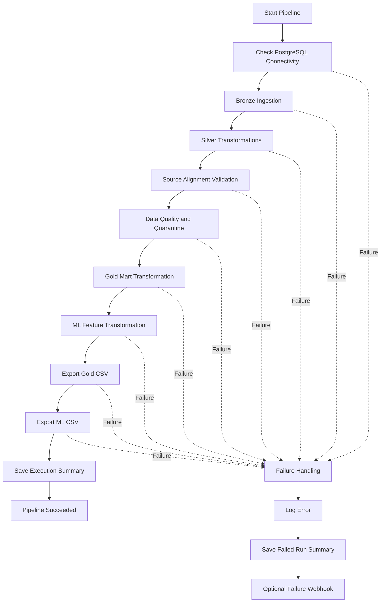

# Architecture and Data Flow

## 1. Logical Architecture

The project follows a Medallion Architecture with separate data quality and ML schemas.



## 2. Pipeline Execution Flow

The orchestration entry point is:

```bash
python scripts/run_pipeline.py
```



A critical stage failure stops subsequent execution.

## 3. Schema Responsibilities

| Schema | Responsibility |
|---|---|
| `bronze` | Original records and ingestion metadata |
| `silver` | Standardised district dimension and fact tables |
| `gold` | District-level outreach analytical mart |
| `ml` | ML-oriented district features and target |
| `dq` | Data quality executions, check results and quarantined records |

## 4. Transformation Dependencies

### Bronze to Silver

- Demographic Bronze records populate the district dimension and demographic fact.
- Housing Bronze records populate the housing fact.
- NSAP Bronze records are parsed into State/UT and pension-scheme rows.
- The source files are preserved in Bronze.

### Silver to Gold

The Gold transformation combines:

- District dimension.
- Demographic fact.
- Housing fact.
- Pension beneficiary fact at its actual State/UT grain.

District-level pension columns remain NULL because the pension source does not contain district-level observations.

### Gold to ML

The ML transformation derives one record per district from the Gold mart.

It includes feature columns, pension availability flags and a binary rule-derived priority target.

## 5. Orchestration and Operations

The Python orchestrator:

- Reads `config/pipeline.yaml`.
- Checks database connectivity.
- Executes Bronze ingestion.
- Executes SQL transformations through `psql`.
- Runs data quality and quarantine.
- Invokes CSV export scripts.
- Records stage-level status, attempts and durations.
- Writes a JSON summary for each execution.
- Sends an optional webhook on pipeline failure.

Retry settings are configurable. Data quality execution is not automatically retried.

## 6. Backfill

The orchestrator supports starting from a selected stage:

```bash
python scripts/run_pipeline.py --start-at silver
python scripts/run_pipeline.py --start-at gold
```

These modes reuse existing upstream data. They do not automatically recreate skipped upstream datasets.

## 7. Runtime Artefacts

| Path | Purpose |
|---|---|
| `logs/pipeline.log` | Application execution log |
| `logs/pipeline_runs/<run-id>.json` | Individual execution summary |
| `reports/data_quality_report.csv` | Data quality check output |
| `reports/unmatched_districts.csv` | Unmatched district output |
| `outputs/mart_district_pension_outreach.csv` | Gold export |
| `outputs/ml_district_features.csv` | ML feature export |
