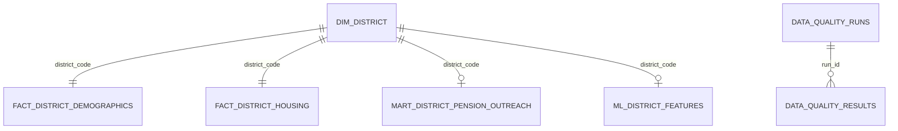

# Data Dictionary

This document describes the 13 PostgreSQL tables implemented in the project.

Column counts and primary keys were verified against the PostgreSQL information schema.

## 1. Table Inventory

| Schema | Table | Column count | Primary key | Grain |
|---|---|---:|---|---|
| Bronze | `census_demographics_raw` | 7 | `raw_record_id` | One original demographic CSV row per source version |
| Bronze | `census_housing_raw` | 7 | `raw_record_id` | One original housing CSV row per source version |
| Bronze | `nsap_pension_raw` | 7 | `raw_record_id` | One original NSAP CSV row per source version |
| Bronze | `ingestion_metadata` | 14 | `ingestion_id` | One source-file ingestion version |
| Silver | `dim_district` | 7 | `district_code` | One Jharkhand district |
| Silver | `fact_district_demographics` | 15 | `district_code` | One Jharkhand district |
| Silver | `fact_district_housing` | 20 | `district_code` | One Jharkhand district |
| Silver | `fact_pension_beneficiaries` | 11 | `pension_beneficiary_id` | One administrative unit and pension scheme |
| Gold | `mart_district_pension_outreach` | 59 | `district_code` | One Jharkhand district |
| ML | `ml_district_features` | 44 | `district_code` | One Jharkhand district |
| DQ | `data_quality_runs` | 8 | `run_id` | One DQ execution |
| DQ | `data_quality_results` | 11 | `result_id` | One check result within a DQ execution |
| DQ | `quarantined_records` | 12 | `quarantine_id` | One quarantined source record and reason |

## 2. Bronze Tables

### `bronze.census_demographics_raw`

Preserves the original demographic CSV rows.

Important columns:

| Column | Meaning |
|---|---|
| `raw_record_id` | Bronze record primary key |
| `ingestion_id` | Link to the ingestion metadata record |
| `source_file_name` | Original source filename |
| `source_sha256` | SHA-256 fingerprint of the source file |
| `source_row_number` | Original CSV row number |
| `ingested_at` | Record ingestion timestamp |
| `raw_record` | Original row stored as JSONB |

### `bronze.census_housing_raw`

Preserves original Census housing CSV rows.

It uses the same seven-column raw-record structure as the demographic Bronze table.

### `bronze.nsap_pension_raw`

Preserves original NSAP source rows, including the Grand Total row.

It uses the same seven-column raw-record structure.

### `bronze.ingestion_metadata`

Stores ingestion execution and source-file metadata.

Important fields include:

- `ingestion_id`
- `source_name`
- `source_file_name`
- `source_relative_path`
- `source_sha256`
- `source_file_size_bytes`
- `source_row_count`
- `loaded_row_count`
- `rejected_row_count`
- `status`
- `pipeline_version`
- `started_at`
- `completed_at`
- `error_message`

A source SHA-256 fingerprint supports idempotent ingestion of unchanged files.

## 3. Silver Tables

### `silver.dim_district`

**Grain:** One record per standardised Jharkhand district.

Primary key: `district_code`.

Contains canonical district identification and administrative attributes used by downstream facts.

### `silver.fact_district_demographics`

**Grain:** One record per Jharkhand district.

Primary key: `district_code`.

Important measures include:

- Total population.
- Male population.
- Female population.
- Literate population.
- Total workers.
- SC population.
- ST population.
- Total households.
- Age-group counts.
- Census source lineage.

### `silver.fact_district_housing`

**Grain:** One record per Jharkhand district.

Primary key: `district_code`.

Contains housing indicators such as:

- Good housing percentage.
- Livable housing percentage.
- Dilapidated housing percentage.
- Permanent housing percentage.
- Semi-permanent housing percentage.
- Temporary housing percentage.
- Serviceable percentage.
- Non-serviceable housing percentage.
- Unclassifiable percentage.

The housing dataset's household reference percentage is not treated as an absolute household count.

### `silver.fact_pension_beneficiaries`

**Grain:** One record per administrative unit and pension scheme.

Primary key: `pension_beneficiary_id`.

Contains administrative-unit identifiers, pension scheme categories and beneficiary counts.

The supplied source produces 108 Silver rows: 36 State/UT administrative units multiplied by three schemes.

The Grand Total row is retained in Bronze and excluded from Silver.

## 4. Gold Table

### `gold.mart_district_pension_outreach`

**Grain:** One record per Jharkhand district.

Primary key: `district_code`.

Contains 59 columns grouped into:

### District identification

- District code.
- District name.
- State name.

### Demographics

- Total population.
- Male and female population.
- Literate population.
- Workers.
- SC and ST population.
- Total households.

### Derived demographic indicators

- Population per household.
- Female population share.
- Literacy rate.
- Work participation rate.
- SC/ST population shares.
- Age 50+ population and share.

### Housing indicators

- Good, livable and dilapidated housing.
- Permanent, semi-permanent and temporary housing.
- Serviceability measures.

### Pension measures

- Old-age pension beneficiary count.
- Widow pension beneficiary count.
- Beneficiary coverage ratios.
- District pension data availability flag.

District-level pension fields remain NULL when unavailable.

### Priority measures

- Seven normalised vulnerability components.
- `pension_outreach_priority_score`.
- `priority_rank`.
- `priority_category`.
- Priority score method.

### Source lineage

- Source filenames.
- Source file hashes.
- Source row numbers.
- Ingestion identifiers.
- Census reference year.

## 5. ML Table

### `ml.ml_district_features`

**Grain:** One record per Jharkhand district.

Primary key: `district_code`.

Contains 44 columns covering:

- District identification.
- Demographic measures.
- Demographic rates and population shares.
- Age 50+ proxy.
- Housing indicators.
- Nullable pension features.
- Pension availability flag.
- Binary priority target.
- Target priority category, rank and score.
- Target definition.
- Feature generation timestamp.

Important target columns:

| Column | Meaning |
|---|---|
| `target_high_priority` | 1 for High priority, 0 otherwise |
| `target_priority_category` | High, Medium or Low |
| `target_priority_rank` | Deterministic district rank |
| `target_priority_score` | Source Gold priority score |
| `target_definition` | Description of the rule-derived target |
| `district_pension_data_available` | Indicates availability of district-level pension data |

The target is derived from the Gold classification. The score, target category, rank and underlying score inputs must not be treated as independent predictors when attempting to reproduce this target.

## 6. Data Quality Tables

### `dq.data_quality_runs`

**Grain:** One record per DQ execution.

Primary key: `run_id`.

Stores execution status, timing, check totals and quarantine totals.

### `dq.data_quality_results`

**Grain:** One record per individual check within a DQ run.

Primary key: `result_id`.

Stores:

- DQ run identifier.
- Check code.
- Layer and table.
- Severity.
- PASS/FAIL status.
- Expected and actual values.
- Details as JSONB.

### `dq.quarantined_records`

**Grain:** One record per quarantined source record and recorded reason.

Primary key: `quarantine_id`.

Preserves the original record payload and associated source lineage, reason and quarantine execution metadata.

## 7. Table Relationships

The pension fact is maintained at State/UT and scheme grain. It must not be joined to districts as though it contained district-level observations.

## 8. Validated Record Counts

| Table | Expected records |
|---|---:|
| `bronze.census_demographics_raw` | 640 |
| `bronze.census_housing_raw` | 640 |
| `bronze.nsap_pension_raw` | 37 |
| `silver.dim_district` | 24 |
| `silver.fact_district_demographics` | 24 |
| `silver.fact_district_housing` | 24 |
| `silver.fact_pension_beneficiaries` | 108 |
| `gold.mart_district_pension_outreach` | 24 |
| `ml.ml_district_features` | 24 |

DQ execution tables grow as new pipeline runs are recorded.

These counts represent the validated assessment execution and are not hard-coded table constraints.

## 9. Important Interpretation Notes

- Census observations refer to 2011.
- The age 50+ measure is not an exact 60+ elderly population count.
- Population per household is a household-pressure proxy, not geographic population density.
- District-level pension counts and coverage measures are unavailable.
- NULL pension values must not be interpreted as zero.
- The priority score is a relative vulnerability proxy, not a measured pension coverage gap.
- The ML target is rule-derived and is not an independently observed outcome.
